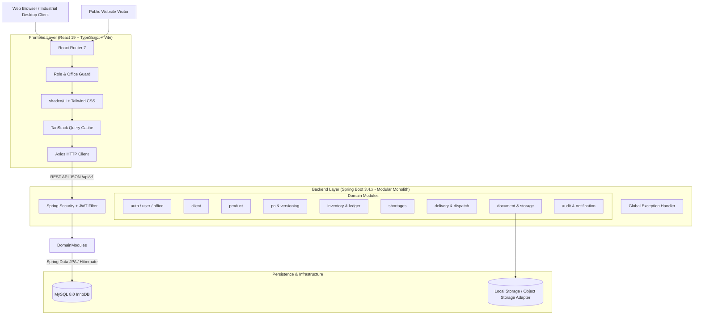
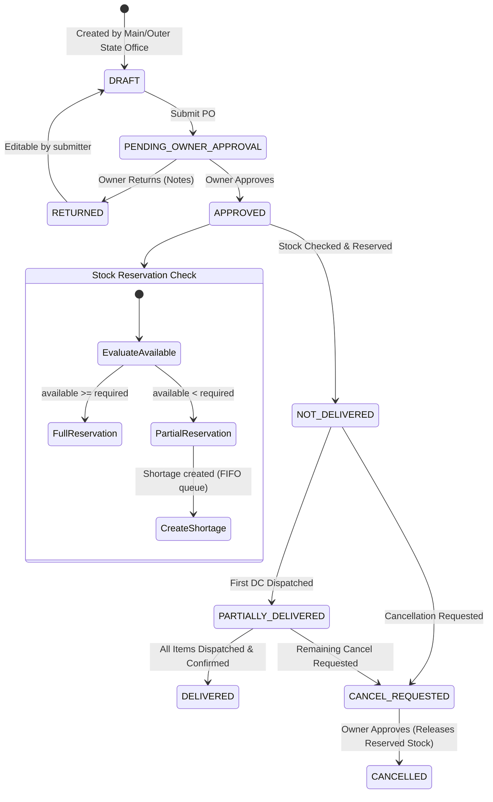
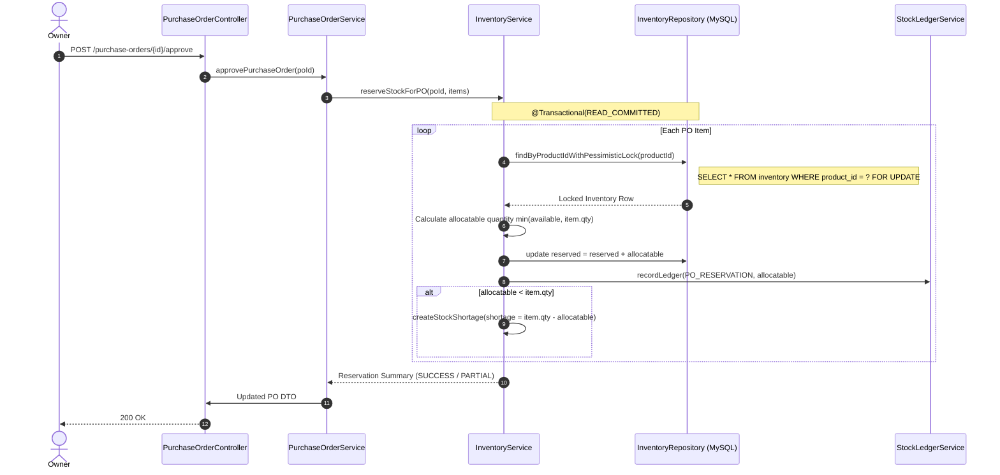

# FACTORY CORE — SYSTEM ARCHITECTURE
**Indo American Equipment / Agrisep®**  
*Factory Management & Inventory Management System*

---

## 1. System Overview & Context

Factory Core is a centralized, high-reliability operational management platform designed specifically for **Indo American Equipment / Agrisep®**, an industrial machinery manufacturer specializing in seed-cleaning machines, gravity separators, destoners, and integrated seed-processing plants.

The system automates the complete operational lifecycle:
- B2B Client and Product catalogs with technical specifications.
- Purchase Order (PO) creation, version control, and multi-tier approval.
- Real-time Godown Inventory with strict mathematical invariants (`AVAILABLE = ON_HAND - RESERVED`).
- Automatic stock reservations and FIFO shortage allocation on stock inward.
- Delivery Challan (DC) generation, physical dispatch, and customer delivery confirmation.
- Immutable stock ledger and business audit logging.



---

## 2. Architectural Principles & Boundaries

1. **Modular Monolith**: All domains reside in a single, well-structured Spring Boot deployment unit. Cross-domain communication occurs via strongly-typed Java interfaces and service calls, rather than uncoordinated HTTP or complex distributed transactions.
2. **Encapsulated Inventory Invariants**: Only the `InventoryService` can update stock balances. Other modules (PO approval, DC dispatch) must invoke designated inventory operations. Direct manipulation of inventory columns from other modules is prohibited.
3. **Pessimistic Concurrency Control**: All stock reservation, allocation, and dispatch operations acquire pessimistic write locks (`SELECT ... FOR UPDATE`) on target inventory records within a database transaction (`@Transactional(isolation = Isolation.READ_COMMITTED)`).
4. **Append-Only Auditing**: Historical ledger entries (`stock_ledger`) and audit logs (`audit_logs`) are strictly append-only. No `UPDATE` or `DELETE` queries are allowed on ledger tables. Corrections are handled exclusively via compensating entries.
5. **No Direct Entity Exposure**: Controllers accept and return strictly validated Data Transfer Objects (DTOs) with Jakarta Validation (`@NotNull`, `@Size`, `@Positive`). Database entities are never exposed in external API contracts.

---

## 3. Backend Package Hierarchy

The backend uses a feature-based, clean modular structure under `com.factory`:

```
com.factory
├── FactoryCoreApplication.java
│
├── common/                     # Cross-cutting foundational capabilities
│   ├── config/                 # Security, WebMvc, Swagger/OpenAPI, JPA Auditing
│   ├── exception/              # GlobalExceptionHandler, BusinessException, ErrorCode
│   ├── response/               # ApiResponse<T>, PageResponse<T>, ErrorResponse
│   ├── security/               # JwtTokenProvider, CustomUserDetailsService, SecurityUtils
│   └── util/                   # DateUtils, SequenceGenerator, StringNormalizer
│
├── auth/                       # Authentication, tokens, and credentials
│   ├── controller/             # AuthController (/login, /refresh, /logout, /me)
│   ├── dto/                    # LoginRequest, TokenResponse, RefreshTokenRequest
│   └── service/                # AuthService, TokenBlacklistService
│
├── user/                       # User management, roles, and profiles
│   ├── controller/             # UserController
│   ├── entity/                 # User, Role, UserOffice
│   ├── repository/             # UserRepository, RoleRepository
│   └── service/                # UserService
│
├── office/                     # Regional branches, headquarters, warehouses
│   ├── controller/             # OfficeController
│   ├── entity/                 # Office (HQ, REGIONAL, WAREHOUSE)
│   └── service/                # OfficeService
│
├── client/                     # B2B Client master directory and addresses
│   ├── controller/             # ClientController
│   ├── entity/                 # Client, ClientAddress, ClientContact
│   └── service/                # ClientService, ClientSnapshotService
│
├── product/                    # Machinery catalog, units, specifications
│   ├── controller/             # ProductController
│   ├── entity/                 # Product, ProductSpec
│   └── service/                # ProductService
│
├── po/                         # Purchase Order lifecycle, items, version history
│   ├── controller/             # PurchaseOrderController
│   ├── entity/                 # PurchaseOrder, POItem, POVersion, POVersionChange
│   └── service/                # PurchaseOrderService, POVersioningService, PONumberGenerator
│
├── inventory/                  # Stock balances, locking, and immutable ledger
│   ├── controller/             # InventoryController, StockLedgerController
│   ├── entity/                 # Inventory, StockLedger
│   └── service/                # InventoryService, StockLedgerService
│
├── shortage/                   # Shortage tracking & deterministic FIFO allocation
│   ├── controller/             # StockShortageController
│   ├── entity/                 # StockShortage
│   └── service/                # StockShortageService, ShortageAllocationEngine
│
├── delivery/                   # Delivery Challans, physical dispatch & proof of delivery
│   ├── controller/             # DeliveryChallanController, DispatchController
│   ├── entity/                 # DeliveryChallan, DCItem, DeliveryRecord
│   └── service/                # DeliveryChallanService, DispatchService, DCNumberGenerator
│
├── notification/               # In-app alerts and notifications
│   ├── controller/             # NotificationController
│   ├── entity/                 # Notification
│   └── service/                # NotificationService
│
├── document/                   # Document metadata and file storage adapter
│   ├── controller/             # DocumentController
│   ├── entity/                 # DocumentMetadata
│   └── service/                # DocumentService, FileStorageAdapter (Local/S3)
│
├── enquiry/                    # Public website enquiries and conversion triage
│   ├── controller/             # WebsiteEnquiryController
│   ├── entity/                 # WebsiteEnquiry
│   └── service/                # WebsiteEnquiryService
│
├── reporting/                  # Multi-criteria aggregations and CSV streaming
│   ├── controller/             # ReportController
│   └── service/                # ReportService, CsvExportService
│
└── audit/                      # Business event auditing and correlation tracking
    ├── entity/                 # AuditLog
    └── service/                # AuditLogService, AuditEventListener
```

---

## 4. Key Workflows & State Machines

### 4.1 Purchase Order Lifecycle & Stock Reservation Flow



### 4.2 Stock Mathematical Invariants & Concurrency Rules

For any product `P`:
$$\text{AVAILABLE} = \text{ON\_HAND} - \text{RESERVED}$$

Subject to continuous database integrity invariants:
$$\text{ON\_HAND} \ge 0$$
$$\text{RESERVED} \ge 0$$
$$\text{RESERVED} \le \text{ON\_HAND}$$

#### Concurrency & Locking Strategy


### 4.3 Dispatch & Delivery Flow

When dispatching a Delivery Challan for quantity $Q$:
1. Check that DC is approved and $Q \le \text{Reserved Quantity}$ and $Q \le \text{Remaining PO Quantity}$.
2. Acquire pessimistic lock on inventory record.
3. Decrement physical inventory:
   $$\text{ON\_HAND} \leftarrow \text{ON\_HAND} - Q$$
   $$\text{RESERVED} \leftarrow \text{RESERVED} - Q$$
   $$\text{AVAILABLE} \leftarrow \text{ON\_HAND} - \text{RESERVED} \quad \text{(remains unchanged by dispatch)}$$
4. Record `DC_DISPATCH` in `stock_ledger`.
5. Update PO item dispatched quantity: `dispatched_quantity += Q`.
6. Update Delivery status (`PARTIALLY_DELIVERED` or ready for `DELIVERED`).

---

## 5. Security & Authorization Architecture

### 5.1 Role Hierarchy & Permissions
1. **OWNER**: Full system authority, PO approval/return, PO cancellation approval, user role & office change approvals, manual inventory adjustments, dispatch approvals.
2. **ADMIN**: User & office management, product master administration, operational oversight, force-logout, technical audit logs. (Cannot approve POs or cancel POs without explicit owner delegation).
3. **MAIN_OFFICE**: Full client master management, PO draft/submission, enquiry triage, inventory stock viewing, PO office assignment.
4. **OUTER_STATE_OFFICE**: PO creation/submission for assigned office/state only. **Strictly prohibited from viewing godown stock quantities, stock ledger, or creating DCs**.
5. **GODOWN_MANAGER**: Physical stock inward, stock adjustments, reservation inspection, DC creation, dispatch execution, delivery confirmation, warehouse dashboard.

### 5.2 Token & Session Strategy
- **Access Tokens**: Short-lived (15 minutes), signed using HMAC-SHA256 with standard claims (`sub`, `roles`, `officeId`, `allowedOffices`, `jti`).
- **Refresh Tokens**: Long-lived (7 days), stored securely in HttpOnly, SameSite=Lax cookies, with server-side rotation on each refresh to prevent token replay.
- **Office/State Scoping**: Requests are evaluated by custom Spring Security expression evaluators (`@PreAuthorize("@securityEvaluator.canAccessPO(authentication, #id)")`).
