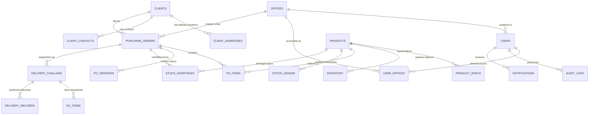

# FACTORY CORE — DATABASE DESIGN & SCHEMA SPECIFICATION
**Indo American Equipment / Agrisep®**  
*Factory Management & Inventory Management System*

---

## 1. Database Architecture & Standards

- **RDBMS Engine**: MySQL 8.0+ with InnoDB storage engine.
- **Character Set**: `utf8mb4` with collation `utf8mb4_0900_ai_ci`.
- **Timestamp Standard**: UTC for all `created_at`, `updated_at`, `po_date`, and transaction timestamps using `TIMESTAMP(3)` or `DATETIME(3)`.
- **Migration Strategy**: Flyway migrations versioned incrementally (`V1__...`, `V2__...`). Automatic Hibernate DDL (`ddl-auto: update`) is strictly disabled in production (`validate` mode).
- **Naming Conventions**: `snake_case` for tables and columns; singular nouns for entities; explicit foreign key prefixes `fk_<table>_<ref_table>`; explicit index prefixes `idx_<table>_<column>`.

---

## 2. Entity-Relationship Diagram (ERD)

---

## 3. Detailed Table Specifications

### 3.1 Security & Organization (`V1__users_and_offices.sql`)

#### `offices`
| Column | Type | Constraints | Description |
|---|---|---|---|
| `id` | VARCHAR(36) | PK | UUID primary key |
| `name` | VARCHAR(100) | NOT NULL | Office / warehouse title |
| `type` | VARCHAR(30) | NOT NULL | `HEADQUARTERS`, `REGIONAL_OFFICE`, `WAREHOUSE_GODOWN` |
| `state` | VARCHAR(50) | NOT NULL | Indian state (e.g., 'Maharashtra', 'Gujarat') |
| `city` | VARCHAR(100) | NOT NULL | City location |
| `address` | TEXT | NOT NULL | Full postal address |
| `gstin` | VARCHAR(15) | NULL | State GSTIN of office |
| `phone` | VARCHAR(20) | NOT NULL | Primary landline/mobile |
| `email` | VARCHAR(100) | NOT NULL | Official contact email |
| `status` | VARCHAR(20) | NOT NULL DEFAULT 'ACTIVE' | `ACTIVE`, `INACTIVE` |
| `created_at` | TIMESTAMP(3) | NOT NULL DEFAULT CURRENT_TIMESTAMP(3) | Creation timestamp |
| `updated_at` | TIMESTAMP(3) | NOT NULL DEFAULT CURRENT_TIMESTAMP(3) | Last update |

#### `users`
| Column | Type | Constraints | Description |
|---|---|---|---|
| `id` | VARCHAR(36) | PK | UUID primary key |
| `email` | VARCHAR(100) | NOT NULL UNIQUE | Unique login email |
| `password_hash` | VARCHAR(255) | NOT NULL | BCrypt password hash |
| `full_name` | VARCHAR(100) | NOT NULL | User's full legal name |
| `phone` | VARCHAR(20) | NOT NULL | Mobile number |
| `role` | VARCHAR(30) | NOT NULL | `OWNER`, `ADMIN`, `MAIN_OFFICE`, `OUTER_STATE_OFFICE`, `GODOWN_MANAGER` |
| `primary_office_id` | VARCHAR(36) | NOT NULL, FK -> offices(id) | Assigned base office |
| `status` | VARCHAR(20) | NOT NULL DEFAULT 'ACTIVE' | `ACTIVE`, `INACTIVE`, `SUSPENDED` |
| `failed_attempts` | INT | NOT NULL DEFAULT 0 | Failed login tracker |
| `locked_until` | TIMESTAMP(3) | NULL | Temporary account lockout |
| `last_login_at` | TIMESTAMP(3) | NULL | Last login timestamp |
| `created_at` | TIMESTAMP(3) | NOT NULL DEFAULT CURRENT_TIMESTAMP(3) | Creation timestamp |
| `updated_at` | TIMESTAMP(3) | NOT NULL DEFAULT CURRENT_TIMESTAMP(3) | Last update |

#### `user_allowed_offices`
| Column | Type | Constraints | Description |
|---|---|---|---|
| `user_id` | VARCHAR(36) | NOT NULL, FK -> users(id) | User reference |
| `office_id` | VARCHAR(36) | NOT NULL, FK -> offices(id) | Permitted office reference |
| *Primary Key* | (user_id, office_id) | PK composite | Multi-office scoping |

---

### 3.2 Master Catalog: Clients & Products (`V2__clients_and_products.sql`)

#### `clients`
| Column | Type | Constraints | Description |
|---|---|---|---|
| `id` | VARCHAR(36) | PK | UUID |
| `company_name` | VARCHAR(150) | NOT NULL | Business legal name |
| `client_type` | VARCHAR(30) | NOT NULL | `PRIVATE_COMPANY`, `GOVT_CORPORATION`, `AGRI_PROCESSOR`, `EXPORTER` |
| `gstin` | VARCHAR(15) | NULL UNIQUE | 15-character Indian GSTIN (normalized) |
| `pan` | VARCHAR(10) | NULL | 10-character Indian PAN |
| `state` | VARCHAR(50) | NOT NULL | Billing state |
| `primary_contact_name`| VARCHAR(100) | NOT NULL | Primary contact |
| `primary_contact_phone`| VARCHAR(20) | NOT NULL | Primary mobile |
| `primary_contact_email`| VARCHAR(100) | NOT NULL | Primary email |
| `credit_days` | INT | NOT NULL DEFAULT 30 | Credit period |
| `status` | VARCHAR(20) | NOT NULL DEFAULT 'ACTIVE' | `ACTIVE`, `INACTIVE` |
| `created_by` | VARCHAR(36) | NOT NULL | User creator UUID |
| `created_at` | TIMESTAMP(3) | NOT NULL DEFAULT CURRENT_TIMESTAMP(3) | Creation timestamp |
| `updated_at` | TIMESTAMP(3) | NOT NULL DEFAULT CURRENT_TIMESTAMP(3) | Last update |

#### `client_addresses`
| Column | Type | Constraints | Description |
|---|---|---|---|
| `id` | VARCHAR(36) | PK | UUID |
| `client_id` | VARCHAR(36) | NOT NULL, FK -> clients(id) | Parent client |
| `site_name` | VARCHAR(100) | NOT NULL | e.g., 'Jalna Factory Site #1' |
| `address_line1` | VARCHAR(255) | NOT NULL | Street / industrial area |
| `city` | VARCHAR(100) | NOT NULL | City |
| `state` | VARCHAR(50) | NOT NULL | State |
| `pincode` | VARCHAR(10) | NOT NULL | 6-digit postal code |
| `contact_person`| VARCHAR(100) | NULL | Site engineer/manager |
| `phone` | VARCHAR(20) | NULL | Site phone |
| `is_default` | BOOLEAN | NOT NULL DEFAULT FALSE | Default dispatch address flag |

#### `products`
| Column | Type | Constraints | Description |
|---|---|---|---|
| `id` | VARCHAR(36) | PK | UUID |
| `sku` | VARCHAR(50) | NOT NULL UNIQUE | Unique model code (e.g. 'AGR-SC-5000') |
| `name` | VARCHAR(150) | NOT NULL | Model name (e.g. 'Fine Seed Cleaner Model A-5') |
| `category` | VARCHAR(50) | NOT NULL | `SEED_CLEANER`, `GRAVITY_SEPARATOR`, `DESTONER`, etc. |
| `unit` | VARCHAR(20) | NOT NULL | `PCS`, `SET`, `UNIT`, `METER`, `KG`, `TON` |
| `description` | TEXT | NULL | Technical overview |
| `base_price_inr`| DECIMAL(12, 2)| NOT NULL DEFAULT 0.00 | Reference price |
| `status` | VARCHAR(20) | NOT NULL DEFAULT 'ACTIVE' | `ACTIVE`, `INACTIVE` |
| `website_visibility`| VARCHAR(20)| NOT NULL DEFAULT 'PUBLIC' | `PUBLIC`, `HIDDEN` |
| `lead_time_weeks` | INT | NOT NULL DEFAULT 2 | Standard manufacturing lead time |
| `created_at` | TIMESTAMP(3) | NOT NULL DEFAULT CURRENT_TIMESTAMP(3) | Creation timestamp |
| `updated_at` | TIMESTAMP(3) | NOT NULL DEFAULT CURRENT_TIMESTAMP(3) | Last update |

---

### 3.3 Purchase Orders & Versioning (`V3__purchase_orders.sql`)

#### `purchase_orders`
| Column | Type | Constraints | Description |
|---|---|---|---|
| `id` | VARCHAR(36) | PK | UUID |
| `po_number` | VARCHAR(30) | NOT NULL UNIQUE | Continuous sequence e.g., 'PO-000001' |
| `po_date` | DATE | NOT NULL | Business PO date |
| `client_id` | VARCHAR(36) | NOT NULL, FK -> clients(id) | Client reference |
| `client_snapshot` | JSON | NOT NULL | Immutable snapshot of client master at PO time |
| `delivery_address` | JSON | NOT NULL | Snapshot of chosen delivery site address |
| `office_id` | VARCHAR(36) | NOT NULL, FK -> offices(id) | Originating branch office |
| `state` | VARCHAR(50) | NOT NULL | State of execution |
| `priority` | VARCHAR(20) | NOT NULL DEFAULT 'NORMAL' | `NORMAL`, `HIGH`, `URGENT` |
| `expected_delivery_date`| DATE | NOT NULL | Promised target delivery date |
| `status` | VARCHAR(30) | NOT NULL DEFAULT 'DRAFT' | `DRAFT`, `PENDING_OWNER_APPROVAL`, `RETURNED`, `APPROVED`, `NOT_DELIVERED`, `PARTIALLY_DELIVERED`, `DELIVERED`, `CANCEL_REQUESTED`, `CANCELLED` |
| `reservation_status` | VARCHAR(30) | NOT NULL DEFAULT 'PENDING' | `PENDING`, `RESERVED`, `PARTIALLY_RESERVED`, `INSUFFICIENT_STOCK`, `RELEASED` |
| `total_amount_inr` | DECIMAL(14, 2)| NOT NULL DEFAULT 0.00 | Total PO value |
| `current_version` | INT | NOT NULL DEFAULT 1 | Version counter |
| `notes` | TEXT | NULL | Special instructions |
| `rejection_reason`| TEXT | NULL | Reason when returned by Owner |
| `cancellation_reason`| TEXT | NULL | Reason when cancel requested |
| `created_by` | VARCHAR(36) | NOT NULL, FK -> users(id) | Creator user |
| `approved_by` | VARCHAR(36) | NULL, FK -> users(id) | Owner user who approved |
| `approved_at` | TIMESTAMP(3) | NULL | Timestamp of approval |
| `created_at` | TIMESTAMP(3) | NOT NULL DEFAULT CURRENT_TIMESTAMP(3) | System creation timestamp |
| `updated_at` | TIMESTAMP(3) | NOT NULL DEFAULT CURRENT_TIMESTAMP(3) | Last update |

#### `po_items`
| Column | Type | Constraints | Description |
|---|---|---|---|
| `id` | VARCHAR(36) | PK | UUID |
| `po_id` | VARCHAR(36) | NOT NULL, FK -> purchase_orders(id) | Parent PO |
| `product_id` | VARCHAR(36) | NOT NULL, FK -> products(id) | Product master reference |
| `product_snapshot` | JSON | NOT NULL | Immutable SKU, name, unit snapshot |
| `quantity` | INT | NOT NULL | Ordered quantity ($> 0$) |
| `reserved_quantity` | INT | NOT NULL DEFAULT 0 | Reserved in godown ($\ge 0$) |
| `dispatched_quantity`| INT | NOT NULL DEFAULT 0 | Physically dispatched ($\ge 0$) |
| `delivered_quantity` | INT | NOT NULL DEFAULT 0 | Confirmed delivered ($\ge 0$) |
| `unit_price_inr` | DECIMAL(12, 2)| NOT NULL DEFAULT 0.00 | Agreed rate |
| *Constraint* | UNIQUE(po_id, product_id) | UK | Prevent duplicate products in same PO |
| *Check* | quantity > 0 | CHECK | Quantity strictly positive |

#### `po_versions`
| Column | Type | Constraints | Description |
|---|---|---|---|
| `id` | VARCHAR(36) | PK | UUID |
| `po_id` | VARCHAR(36) | NOT NULL, FK -> purchase_orders(id) | Parent PO |
| `version_number` | INT | NOT NULL | e.g. 1, 2, 3 |
| `reason` | VARCHAR(255) | NOT NULL | Reason for new version |
| `snapshot_json` | LONGTEXT | NOT NULL | Complete serialized snapshot of PO & items |
| `created_by` | VARCHAR(36) | NOT NULL, FK -> users(id) | Editor user |
| `created_at` | TIMESTAMP(3) | NOT NULL DEFAULT CURRENT_TIMESTAMP(3) | Version creation time |
| *Constraint* | UNIQUE(po_id, version_number) | UK | Unique version per PO |

---

### 3.4 Inventory, Shortages & Stock Ledger (`V4__inventory_and_shortages.sql`)

#### `inventory`
| Column | Type | Constraints | Description |
|---|---|---|---|
| `id` | VARCHAR(36) | PK | UUID |
| `product_id` | VARCHAR(36) | NOT NULL UNIQUE, FK -> products(id) | One inventory record per product |
| `on_hand` | INT | NOT NULL DEFAULT 0 | Total physical units in warehouse |
| `reserved` | INT | NOT NULL DEFAULT 0 | Units committed to approved POs |
| `warehouse_location`| VARCHAR(50)| NOT NULL DEFAULT 'JALNA-GODOWN-1' | Storage warehouse location |
| `reorder_point` | INT | NOT NULL DEFAULT 5 | Minimum safety threshold |
| `version` | BIGINT | NOT NULL DEFAULT 0 | Optimistic locking counter |
| `updated_at` | TIMESTAMP(3) | NOT NULL DEFAULT CURRENT_TIMESTAMP(3) | Last stock modification |
| *Check 1* | on_hand >= 0 | CHECK | Stock cannot be negative |
| *Check 2* | reserved >= 0 | CHECK | Reserved cannot be negative |
| *Check 3* | reserved <= on_hand | CHECK | Reserved cannot exceed on-hand |

#### `stock_ledger` (Append-Only)
| Column | Type | Constraints | Description |
|---|---|---|---|
| `id` | VARCHAR(36) | PK | UUID |
| `timestamp` | TIMESTAMP(3) | NOT NULL DEFAULT CURRENT_TIMESTAMP(3) | Movement timestamp |
| `product_id` | VARCHAR(36) | NOT NULL, FK -> products(id) | Product moved |
| `transaction_type` | VARCHAR(30) | NOT NULL | `INITIAL_STOCK`, `PO_RESERVATION`, `PO_UNRESERVATION`, `DC_DISPATCH`, `MANUAL_ADJUSTMENT`, `STOCK_INWARD` |
| `quantity_delta` | INT | NOT NULL | Signed movement ($+Q$ or $-Q$) |
| `balance_on_hand` | INT | NOT NULL | Physical on-hand balance after transaction |
| `balance_reserved`| INT | NOT NULL | Reserved balance after transaction |
| `reference_type` | VARCHAR(30) | NOT NULL | `PURCHASE_ORDER`, `DELIVERY_CHALLAN`, `MANUAL_ADJUSTMENT` |
| `reference_id` | VARCHAR(36) | NOT NULL | Related business document ID |
| `reference_number`| VARCHAR(50) | NULL | Document number (e.g. 'PO-000001', 'DC-000001') |
| `user_id` | VARCHAR(36) | NOT NULL, FK -> users(id) | User who executed operation |
| `remarks` | VARCHAR(255) | NOT NULL | Audit remark / justification |

#### `stock_shortages`
| Column | Type | Constraints | Description |
|---|---|---|---|
| `id` | VARCHAR(36) | PK | UUID |
| `po_id` | VARCHAR(36) | NOT NULL, FK -> purchase_orders(id) | Target PO |
| `product_id` | VARCHAR(36) | NOT NULL, FK -> products(id) | Product in deficit |
| `required_quantity`| INT | NOT NULL | Total ordered item quantity |
| `reserved_quantity`| INT | NOT NULL DEFAULT 0 | Quantity reserved so far |
| `shortage_quantity`| INT | NOT NULL | Remaining deficit ($required - reserved$) |
| `po_date` | DATE | NOT NULL | PO date for FIFO sorting |
| `expected_delivery_date`| DATE | NOT NULL | Secondary FIFO sorting |
| `status` | VARCHAR(30) | NOT NULL DEFAULT 'OPEN' | `OPEN`, `PARTIALLY_RESOLVED`, `RESOLVED` |
| `created_at` | TIMESTAMP(3) | NOT NULL DEFAULT CURRENT_TIMESTAMP(3) | Creation timestamp |
| `resolved_at` | TIMESTAMP(3) | NULL | Timestamp when shortage hit 0 |

---

### 3.5 Delivery Challans, Dispatches & Deliveries (`V5__delivery_challans.sql`)

#### `delivery_challans`
| Column | Type | Constraints | Description |
|---|---|---|---|
| `id` | VARCHAR(36) | PK | UUID |
| `dc_number` | VARCHAR(30) | NOT NULL UNIQUE | Continuous sequence e.g., 'DC-000001' |
| `po_id` | VARCHAR(36) | NOT NULL, FK -> purchase_orders(id) | Associated PO |
| `status` | VARCHAR(30) | NOT NULL DEFAULT 'DRAFT' | `DRAFT`, `PENDING_APPROVAL`, `APPROVED`, `DISPATCHED`, `DELIVERED`, `CANCELLED` |
| `vehicle_number` | VARCHAR(20) | NOT NULL | Transport vehicle registration |
| `transporter_name`| VARCHAR(100) | NOT NULL | Logistics company name |
| `driver_name` | VARCHAR(100) | NOT NULL | Driver's full name |
| `driver_phone` | VARCHAR(20) | NOT NULL | Driver's mobile |
| `eway_bill_number`| VARCHAR(30) | NOT NULL | Government E-Way Bill identifier |
| `dispatch_date` | DATE | NULL | Date of physical warehouse exit |
| `expected_arrival_date`| DATE | NOT NULL | Expected customer site arrival |
| `created_by` | VARCHAR(36) | NOT NULL, FK -> users(id) | Creator (Godown Manager) |
| `approved_by` | VARCHAR(36) | NULL, FK -> users(id) | Approver (Owner / Delegated Admin) |
| `created_at` | TIMESTAMP(3) | NOT NULL DEFAULT CURRENT_TIMESTAMP(3) | System creation timestamp |
| `updated_at` | TIMESTAMP(3) | NOT NULL DEFAULT CURRENT_TIMESTAMP(3) | Last update |

#### `dc_items`
| Column | Type | Constraints | Description |
|---|---|---|---|
| `id` | VARCHAR(36) | PK | UUID |
| `dc_id` | VARCHAR(36) | NOT NULL, FK -> delivery_challans(id) | Parent DC |
| `product_id` | VARCHAR(36) | NOT NULL, FK -> products(id) | Product |
| `dispatch_quantity`| INT | NOT NULL | Quantity in this dispatch ($> 0$) |
| `unit` | VARCHAR(20) | NOT NULL | Unit of measure |
| *Check* | dispatch_quantity > 0 | CHECK | Strict positive quantity |

#### `delivery_records`
| Column | Type | Constraints | Description |
|---|---|---|---|
| `id` | VARCHAR(36) | PK | UUID |
| `dc_id` | VARCHAR(36) | NOT NULL UNIQUE, FK -> delivery_challans(id) | One delivery confirmation per DC |
| `delivery_date` | DATE | NOT NULL | Confirmed customer receipt date |
| `received_by` | VARCHAR(100) | NOT NULL | Customer representative name |
| `receiver_contact`| VARCHAR(20) | NOT NULL | Customer phone |
| `remarks` | TEXT | NULL | Site delivery notes |
| `pod_document_id`| VARCHAR(36) | NULL | Proof of Delivery upload reference |
| `confirmed_by` | VARCHAR(36) | NOT NULL, FK -> users(id) | Godown Manager UUID |
| `confirmed_at` | TIMESTAMP(3) | NOT NULL DEFAULT CURRENT_TIMESTAMP(3) | System verification time |

---

### 3.6 Notifications, Auditing & Enquiries (`V6__auxiliary_tables.sql`)

#### `notifications`
| Column | Type | Constraints | Description |
|---|---|---|---|
| `id` | VARCHAR(36) | PK | UUID |
| `user_id` | VARCHAR(36) | NOT NULL, FK -> users(id) | Recipient user |
| `type` | VARCHAR(40) | NOT NULL | Notification event code |
| `title` | VARCHAR(150) | NOT NULL | Notification headline |
| `message` | TEXT | NOT NULL | Notification body |
| `related_record_type`| VARCHAR(30)| NOT NULL | `PO`, `DC`, `SHORTAGE`, `ENQUIRY`, `INVENTORY` |
| `related_record_id`| VARCHAR(36)| NOT NULL | Target entity UUID |
| `related_record_number`| VARCHAR(50)| NULL | Target business code (e.g. 'PO-000001') |
| `is_read` | BOOLEAN | NOT NULL DEFAULT FALSE | Unread status flag |
| `created_at` | TIMESTAMP(3) | NOT NULL DEFAULT CURRENT_TIMESTAMP(3) | Creation timestamp |

#### `audit_logs` (Append-Only)
| Column | Type | Constraints | Description |
|---|---|---|---|
| `id` | VARCHAR(36) | PK | UUID |
| `correlation_id` | VARCHAR(36) | NOT NULL | Trace request correlation ID |
| `timestamp` | TIMESTAMP(3) | NOT NULL DEFAULT CURRENT_TIMESTAMP(3) | Event time |
| `user_id` | VARCHAR(36) | NULL | Performing user UUID |
| `user_name` | VARCHAR(100) | NOT NULL | User name or 'SYSTEM' |
| `user_role` | VARCHAR(30) | NOT NULL | User role |
| `action` | VARCHAR(50) | NOT NULL | `PO_CREATE`, `PO_APPROVE`, `STOCK_RESERVE`, etc. |
| `resource_type` | VARCHAR(40) | NOT NULL | Resource category |
| `resource_id` | VARCHAR(36) | NOT NULL | Resource UUID |
| `resource_identifier`| VARCHAR(50)| NULL | Display code (e.g. 'PO-000001') |
| `old_value` | LONGTEXT | NULL | Previous state snapshot (JSON/text) |
| `new_value` | LONGTEXT | NULL | New state snapshot (JSON/text) |
| `ip_address` | VARCHAR(45) | NOT NULL | Client IP address |

#### `website_enquiries`
| Column | Type | Constraints | Description |
|---|---|---|---|
| `id` | VARCHAR(36) | PK | UUID |
| `name` | VARCHAR(100) | NOT NULL | Prospective client name |
| `company` | VARCHAR(150) | NULL | Client company |
| `phone` | VARCHAR(20) | NOT NULL | Mobile number |
| `email` | VARCHAR(100) | NOT NULL | Email address |
| `product_id` | VARCHAR(36) | NULL, FK -> products(id) | Machinery of interest |
| `quantity` | INT | NULL | Required machines |
| `message` | TEXT | NOT NULL | Message inquiry |
| `state` | VARCHAR(50) | NULL | State location |
| `status` | VARCHAR(30) | NOT NULL DEFAULT 'NEW' | `NEW`, `CONTACTED`, `FOLLOW_UP`, `CONVERTED`, `CLOSED` |
| `assigned_to` | VARCHAR(36) | NULL, FK -> users(id) | Assigned Main Office user |
| `created_at` | TIMESTAMP(3) | NOT NULL DEFAULT CURRENT_TIMESTAMP(3) | Submission timestamp |

#### `system_sequences` (Sequential Number Generator Table)
| Column | Type | Constraints | Description |
|---|---|---|---|
| `sequence_name` | VARCHAR(50) | PK | e.g. 'PO_NUMBER', 'DC_NUMBER' |
| `current_value` | BIGINT | NOT NULL | Monotonically increasing counter |

*Concurrency Pattern*: `SELECT current_value FROM system_sequences WHERE sequence_name = 'PO_NUMBER' FOR UPDATE; UPDATE system_sequences SET current_value = current_value + 1 WHERE sequence_name = 'PO_NUMBER';`
This guarantees zero gaps and zero duplicates even under concurrent threads.
