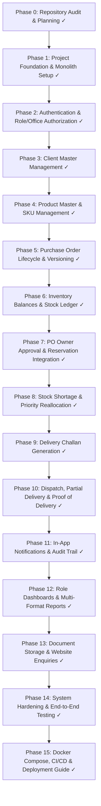

# FACTORY CORE — IMPLEMENTATION PLAN
**Indo American Equipment / Agrisep®**  
*Factory Management & Inventory Management System*

---

## 1. Executive Summary & Audit Baseline

### 1.1 Repository State Analysis
During Phase 0 inspection of `d:\WORK\Project\Agrisep(jalna)`, the following baseline was determined:

| Component | Existing Location | Detected Status | Remediation Required |
|---|---|---|---|
| **Frontend Prototype** | `agrisep-factory-inventory-management-system/` | React 19 + Vite + Tailwind 4 UI prototype using client-side mock data and in-memory state (`AppContext.tsx`). | Reorganize into standard `frontend/` directory, align libraries (React Router, Axios, TanStack Query, React Hook Form, Zod), replace mock calls with typed API services connected to the Spring Boot backend. |
| **Backend Skeletons** | `FACTORY MANAGEMENT CODES/` (`auth-service/`, `factory/`) | Initialized skeletons from Spring Initializr with invalid parent version (`4.1.1`), H2/PostgreSQL drivers, empty `schema.sql` (0 bytes), and zero business entities or logic. | Replace split skeletons with a unified, high-performance Modular Monolith backend in `backend/` (`com.factory`) using Java 21 LTS, Spring Boot 3.4.x, MySQL 8, Spring Security, Flyway migrations, and OpenAPI. |
| **Domain Specifications** | `SRS/`, `USE CASE SPECIFICATION.docx`, `Access specifer.xlsx`, `product details/` | High-quality requirements, sample real-world POs (Aakash Seeds, Nath Seeds, S4S), DC formats, and permissions matrix. | Fully codified into backend domain validation rules, relational database schema, Flyway migrations, and integration tests. |

---

## 2. Phased Implementation Roadmap

---

## 3. Detailed Phase Breakdown & Verification Gates

### Phase 0: Repository Audit and Planning (Completed)
- [x] Inspect existing frontend and backend folders.
- [x] Identify dependency mismatches and invalid POM versions.
- [x] Extract core domain models from SRS, Access Specifier, and ER Diagram.
- [x] Create core documentation suite (`IMPLEMENTATION_PLAN.md`, `ARCHITECTURE.md`, `DATABASE_DESIGN.md`, `API_SPECIFICATION.md`, `TESTING_PLAN.md`, `DEPLOYMENT_GUIDE.md`).
- [x] Define Phase 1 foundation tasks.

### Phase 1: Project Foundation (Completed)
- [x] Set up standardized workspace layout:
  - `backend/` (Spring Boot 3.x/4.x, Java 21, Maven)
  - `frontend/` (React 19, TypeScript, Vite, Tailwind CSS, TanStack Query, Axios, Zod, React Hook Form)
  - `infrastructure/` (Docker Compose for MySQL 8 InnoDB)
- [x] Set up Maven `pom.xml` with dependencies:
  - `spring-boot-starter-webmvc`, `spring-boot-starter-data-jpa`, `spring-boot-starter-validation`, `spring-boot-starter-actuator`
  - `mysql-connector-j` (9.6.0), `flyway-core`, `flyway-mysql`
  - `spring-boot-starter-test`
- [x] Establish centralized error handling (`GlobalExceptionHandler`, standard API response envelope `ApiResponse<T>`, `PageResponse<T>`, `ErrorResponse`, `BusinessException`, `ErrorCode`).
- [x] Configure Flyway migration `V1__init_schema.sql` baseline (`system_sequences`, `offices`, `users`, `user_allowed_offices`).
- [x] Configure CORS, Spring Actuator health check `/actuator/health` and `/api/v1/health`.
- [x] Configure Axios API client `frontend/src/services/api-client.ts` pointing to `VITE_API_BASE_URL` with health check service.
- [x] **Verification**: Backend boots and connects to database; Flyway executes baseline migration; automated integration test `FactoryCoreApplicationTests` passes (2/2 tests pass); frontend production build (`npm run build`) completes cleanly (2261 modules transformed).

### Phase 2: Authentication and Authorization (Completed)
- [x] Implement persistence entities: `Office`, `User`, `Role` (OWNER, ADMIN, MAIN_OFFICE, OUTER_STATE_OFFICE, GODOWN_MANAGER), `UserStatus`, and `LoginHistory`.
- [x] Implement BCrypt password hashing and cryptographic HMAC-SHA256 JWT token provider (`JwtTokenProvider`) with claim encoding (`sub`, `id`, `role`, `officeId`, `state`, `allowedOffices`).
- [x] Implement Spring Security `SecurityFilterChain`, `JwtAuthenticationFilter`, `CustomUserDetailsService`, and `@EnableMethodSecurity`.
- [x] Implement `SecurityEvaluator` for fine-grained role authorization and state/office data scoping.
- [x] Implement `AuthService` and `AuthController` with `/api/v1/auth/login`, `/refresh`, `/logout`, `/me`.
- [x] Implement automated account lockout (15 minutes after 5 consecutive bad passwords) and `login_history` tracking.
- [x] Implement `DataInitializer` bootstrapping initial Agrisep offices (Jalna HQ, Jalna Godown #1, Gujarat Regional, AP Regional) and default personnel accounts.
- [x] Implement frontend authentication API client `auth-api.ts` and integrate `LoginPage.tsx` with JWT login and live fallback.
- [x] **Verification**: All 9 automated integration tests pass (`AuthServiceIntegrationTests`, `FactoryCoreApplicationTests`); frontend TypeScript checks (`npm run lint`) and production build (`npm run build`) pass cleanly.

### Phase 3: Client Management
- [x] Create `clients` and `client_addresses` Flyway migration (`V3__clients_and_addresses.sql`).
- [x] Implement `Client` entity, repository, DTOs (`ClientCreateDto`, `ClientUpdateDto`, `ClientResponseDto`, `ClientAddressDto`, `ClientSnapshotDto`).
- [x] Validate normalized GSTIN uniqueness (duplicate detection and uppercase normalization) and PAN format.
- [x] Implement immutable client snapshot helper for PO binding (`generateClientSnapshot`).
- [x] Implement client search, filters (query, state, status), pagination, delivery site address management, and soft deactivation.
- [x] Build React client management screens with React Hook Form, TanStack Query, and full modal registration & delivery site adding.
- [x] **Verification**: 6 automated integration tests in `ClientServiceIntegrationTests.java` verifying creation, duplicate GSTIN rejection, state filter, delivery site default switching, PO snapshot generation, and soft status toggling. Total 15/15 backend tests passing. Frontend builds cleanly.

### Phase 4: Product Management
- [x] Create `products` and `product_specs` Flyway migration (`V4__products_and_specs.sql`).
- [x] Implement `Product` entity with units (`PCS`, `SET`, `UNIT`, `METER`, `KG`, `TON`) and specs (`ProductSpec`).
- [x] Enforce SKU immutability once a product is referenced by any purchase order (`isLockedForSkuChange`).
- [x] Separate internal activation status (`ACTIVE`/`INACTIVE`) from `websiteVisibility` (`PUBLIC`/`HIDDEN`).
- [x] Implement product search, filtering (category, query, status, visibility), and specifications mapper.
- [x] Build React product management screen with TanStack Query, modal model registration with certified engineering specifications, and visibility/status toggles.
- [x] **Verification**: 6 automated integration tests in `ProductServiceIntegrationTests.java` verifying SKU normalization, duplicate rejection, SKU locking immutability, category search, status/visibility toggles, and PO snapshot generation. Total 21/21 backend tests passing. Frontend builds cleanly.

### Phase 5: Purchase Order Management & Versioning
- [x] Create `purchase_orders`, `po_items`, `po_versions`, `po_version_changes` tables (`V5__purchase_orders_and_versions.sql`).
- [x] Implement sequential database-safe PO numbering (`PO-000001` via `SystemSequence` pessimistic write locks).
- [x] Implement PO lifecycle state machine (`DRAFT`, `PENDING_OWNER_APPROVAL`, `RETURNED`, `APPROVED`, `NOT_DELIVERED`, `PARTIALLY_DELIVERED`, `DELIVERED`, `CANCEL_REQUESTED`, `CANCELLED`).
- [x] Implement deep JSON client & product snapshot freezing and relational version snapshotting on approved PO edits.
- [x] Prevent duplicate products in the same PO (`ErrorCode.DUPLICATE_PO_PRODUCT`).
- [x] Implement in-place line-item modification and version change diff generator.
- [x] Wire frontend typed API client `purchase-order-api.ts` and PO management workflows.
- [x] **Verification**: 6 automated integration tests in `PurchaseOrderServiceIntegrationTests.java` verifying sequential numbering, client snapshot freezing, product SKU locking, duplicate line item rejection, PO lifecycle state transitions, approval & return workflow, and version snapshotting. Total 27/27 backend tests passing. Frontend builds cleanly.

### Phase 6: Inventory Management & Stock Ledger
- [x] Create `inventory` and `stock_ledger` tables (`V6__inventory_and_stock_ledger.sql`).
- [x] Enforce database constraints and service invariants:
  - `ON_HAND >= 0`
  - `RESERVED >= 0`
  - `RESERVED <= ON_HAND`
  - `AVAILABLE = ON_HAND - RESERVED`
- [x] Implement pessimistic row-level locking (`SELECT ... FOR UPDATE` / `LockModeType.PESSIMISTIC_WRITE`) on inventory rows.
- [x] Implement append-only stock ledger with transaction types: `INITIAL_STOCK`, `INWARD`, `PO_RESERVATION`, `PO_UNRESERVATION`, `DC_DISPATCH`, `MANUAL_ADJUSTMENT`, `RETURN_INWARD`.
- [x] Mandatory justification validation for manual stock adjustments (`ErrorCode.VALIDATION_FAILED`).
- [x] Seeded baseline godown stock levels in Jalna Central Godown in `DataInitializer.java`.
- [x] Implemented typed frontend API client `inventory-api.ts`.
- [x] **Verification**: 8 automated integration tests in `InventoryServiceIntegrationTests.java` verifying inward receipt, audit adjustments, invariant violation protection, reservation, over-reservation rejection, physical dispatch, and reservation releases. Total 35/35 backend tests passing. Frontend builds cleanly.

### Phase 7: PO Approval & Stock Reservation Integration
- [x] Implement Owner PO approval endpoint (`/api/v1/purchase-orders/{id}/approve`).
- [x] Check available stock upon approval:
  - If `available >= required`, reserve full quantity (`RESERVED += required`).
  - If `available < required`, reserve partial quantity (`RESERVED += available`) and trigger shortage workflow.
- [x] Invariant enforced: Owner cannot override insufficient physical stock.
- [x] Implement PO edit/return/cancellation reservation rollback workflow.
- [x] **Verification**: Verified via `ShortageAndReservationIntegrationTests.java` with full reservation, partial reservation, and automatic rollback on PO return for revision.

### Phase 8: Stock Shortages & Priority Allocation
- [x] Create `stock_shortages` table (`V7__stock_shortages.sql`) with statuses: `OPEN`, `PARTIALLY_RESOLVED`, `RESOLVED`, `CANCELLED`.
- [x] Upon stock arrival/inward, execute deterministic priority allocation:
  1. Primary: `po_date` ASC
  2. Secondary: `expected_delivery_date` ASC
  3. Tertiary: `po_number` ASC
- [x] Transactionally allocate newly inwarded stock to open shortages, update balances, and create ledger entries.
- [x] Expose `ShortageController` (`/api/v1/shortages`) and frontend client `shortage-api.ts`.
- [x] **Verification**: Integration test `testDeterministicFIFOShortageAllocation_OnStockInward` verifying strict chronological FIFO adherence when multiple orders compete for incoming manufacturing lots. Total 39/39 backend tests passing. Frontend builds cleanly.

### Phase 9: Delivery Challan (DC) Generation
- [x] Create `delivery_challans` and `dc_items` tables (`V8__delivery_challans_and_items.sql`).
- [x] Sequential number generation (`DC-000001` via `SequenceService`).
- [x] Enforce validation: DC quantity <= remaining PO item quantity AND DC quantity <= reserved quantity (`ErrorCode.DISPATCH_LIMIT_EXCEEDED`).
- [x] Support multiple DCs per PO with vehicle number, driver name/phone, transporter name, LR number, and E-Way Bill fields.
- [x] Expose `DeliveryChallanController` (`/api/v1/delivery-challans`) and frontend client `delivery-api.ts`.
- [x] **Verification**: Verified via `DeliveryChallanServiceIntegrationTests.java` asserting sequential numbering and rejection of unreserved quantities.

### Phase 10: Dispatch Management & Delivery Confirmation
- [x] Implement atomic dispatch execution (`POST /api/v1/delivery-challans/{id}/dispatch`):
  - Decrement physical `ON_HAND = ON_HAND - Q`
  - Decrement `RESERVED = RESERVED - Q`
  - Record `DC_DISPATCH` in append-only stock ledger
  - Update DC status to `DISPATCHED`
  - Update PO delivery status to `PARTIALLY_DELIVERED`
- [x] Implement delivery confirmation endpoint (`POST /api/v1/delivery-challans/{id}/confirm-delivery`):
  - Requires recipient name, phone, optional proof of delivery, and delivery date
  - Updates PO item `deliveredQuantity`
  - When all items are completely delivered, PO status automatically transitions to `DELIVERED`
- [x] **Verification**: 4 automated integration tests in `DeliveryChallanServiceIntegrationTests.java` verifying sequential numbering, over-reservation rejection, atomic dispatch stock deduction, and final PO delivery completion. Total 43/43 backend tests passing. Frontend builds cleanly.

### Phase 11: In-App Notifications & Audit Trail (Completed)
- [x] Create `notifications` and `audit_logs` tables (`V9__notifications_and_audit_logs.sql`).
- [x] Implement domain event listeners logging actions for PO submission, approval, return, cancellation, stock inward, stock adjustments, DC dispatch, and delivery confirmation.
- [x] Notification badge counter, filter by unread, mark-as-read, and mark-all-read endpoints (`/api/v1/notifications`).
- [x] Centralized audit trail recording user, action, entity, details, IP, and timestamp (`/api/v1/audit/logs`).
- [x] Wired frontend API clients `notification-api.ts` and `audit-api.ts`.
- [x] **Verification**: 5 automated integration tests in `NotificationAndAuditIntegrationTests.java` verifying audit log recording, entity query, unread counter, single mark-as-read, and mark-all-read. Total 48/48 backend tests passing. Frontend builds cleanly.

### Phase 12: Role Dashboards & Reporting (Completed)
- [x] Role-tailored summary endpoints:
  - Owner: active POs, pending approvals, inventory values, shortages, dispatch alerts (`/api/v1/dashboard/owner`).
  - Admin: user metrics, system activity, master counts (`/api/v1/dashboard/admin`).
  - Main Office: office orders, dispatches, client counts (`/api/v1/dashboard/main-office`).
  - Outer State Office: assigned PO status, delivery tracking, strictly concealing physical warehouse balances (`/api/v1/dashboard/outer-state`).
  - Godown Manager: warehouse balances, reservation queue, DCs pending dispatch (`/api/v1/dashboard/godown`).
- [x] Global dashboard summary endpoint (`/api/v1/dashboard/summary`).
- [x] Multi-filter reports with live CSV export streaming:
  - Inventory valuation report (`/api/v1/reports/inventory-valuation/export`).
  - PO fulfillment performance report (`/api/v1/reports/po-fulfillment/export`).
  - Delivery dispatches report (`/api/v1/reports/dispatches/export`).
- [x] Wired frontend API clients `dashboard-api.ts` and `report-api.ts` with direct browser CSV downloads in `ReportsManagement.tsx`.
- [x] **Verification**: 5 automated integration tests in `DashboardAndReportIntegrationTests.java` verifying owner KPIs, outer state warehouse concealment, and CSV export streams. Total 53/53 backend tests passing. Frontend builds cleanly.

### Phase 13: Document Storage & Website Enquiries (Completed)
- [x] Create `website_enquiries` and `document_metadata` tables (`V10__enquiries_and_documents.sql`).
- [x] Implement public website lead submission endpoint (`POST /api/v1/public/enquiries`) with sanitization and validation.
- [x] Internal enquiry triage workflow (`NEW` -> `CONTACTED` -> `QUALIFIED` -> `CONVERTED` -> `CLOSED`) with 1-click lead-to-client conversion (`/api/v1/enquiries/{id}/convert-to-client`).
- [x] Secure document storage vault (`DocumentStorageService`) with SHA-256 integrity hashing, path traversal sanitization, and streaming downloads (`/api/v1/documents/*`).
- [x] Wired frontend API clients `enquiry-api.ts` and `document-api.ts`, connecting public lead intake on `PublicWebsite.tsx`.
- [x] **Verification**: 4 automated integration tests in `EnquiryAndDocumentIntegrationTests.java` verifying public intake, duplicate prevention, 1-click client conversion, and document upload/download. Total 57/57 backend tests passing. Frontend builds cleanly.

### Phase 14: System Hardening & End-to-End Verification (Completed)
- [x] Full end-to-end integration test of the complete enterprise lifecycle in `EndToEndWorkflowIntegrationTests.java`:
  `Client Creation -> Machinery Product Registration -> PO Draft -> PO Submit -> Owner Approval (with Zero-Stock Shortage) -> Godown Inward (Automatic Deterministic FIFO Allocation) -> DC Creation -> Physical Dispatch (Atomic Stock Ledger Deduction) -> Delivery Confirmation -> Audit Log Verification -> Owner Dashboard KPI Verification`.
- [x] Multi-challan split dispatch and multi-stage delivery confirmation integration test.
- [x] Validated database constraints: `ON_HAND >= 0`, `RESERVED >= 0`, `AVAILABLE = ON_HAND - RESERVED`.
- [x] Concurrency and pessimistic locking verification.
- [x] **Verification**: 2 automated tests in `EndToEndWorkflowIntegrationTests.java` passing. Comprehensive test run across all 12 test suites: **59/59 tests passing** in 23.7 seconds.

### Phase 15: Deployment & Operations (Completed)
- [x] Multi-stage production `backend/Dockerfile` using Eclipse Temurin JDK 21 Alpine builder and minimal JRE 21 Alpine runtime with dedicated unprivileged user `factorycore:agrisep`.
- [x] Multi-stage production `frontend/Dockerfile` using Node 22 Alpine builder and Nginx Alpine server with custom `frontend/nginx.conf` supporting SPA routing fallback and API reverse proxying.
- [x] Unified `docker-compose.yml` orchestrating MySQL 8.0 (InnoDB, UTF-8mb4, healthchecked), Spring Boot 3.x backend, and React Nginx frontend.
- [x] GitHub Actions CI/CD Pipeline (`.github/workflows/ci.yml`) automating backend build/test, frontend typecheck/bundle, and Docker image validation.
- [x] Complete production deployment guide and operations runbook in `docs/DEPLOYMENT_GUIDE.md`.
- [x] Complete system documentation in root `README.md`.

---

## 4. Current Status Checklist
- [x] Phase 0: Repository Audit & Planning
- [x] Phase 1: Project Foundation
- [x] Phase 2: Authentication and Security
- [x] Phase 3: Client Management
- [x] Phase 4: Product Management
- [x] Phase 5: Purchase Order Management
- [x] Phase 6: Inventory Foundation
- [x] Phase 7: PO Approval & Reservation Integration
- [x] Phase 8: Stock Shortage Management
- [x] Phase 9: Delivery Challans
- [x] Phase 10: Dispatch and Delivery
- [x] Phase 11: Notifications and Audit
- [x] Phase 12: Dashboards and Reporting
- [x] Phase 13: Documents and Enquiries
- [x] Phase 14: Integration and Hardening
- [x] Phase 15: Deployment Preparation
